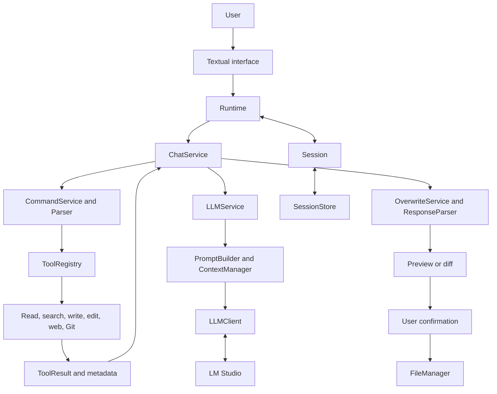
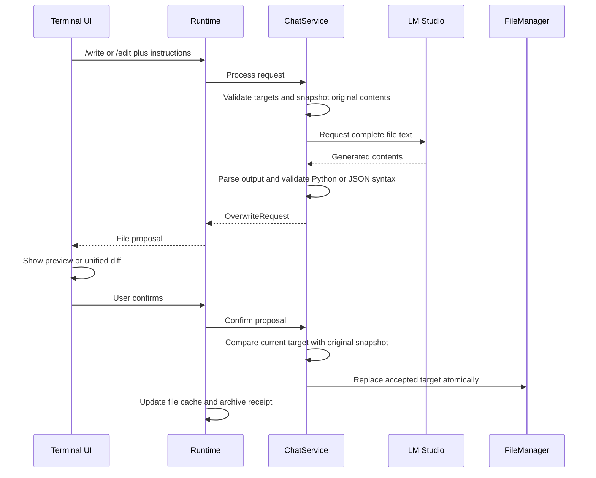

# Architecture

[README](../README.md) · [Tools](tools.md) · [Sessions](sessions.md) · [Development](development.md)

## System design

AdityaCLI is a single-process terminal application. Its deterministic runtime
owns command routing, file access, subprocess execution, and persistence. A model
served by LM Studio receives text messages and produces text. Model output is
never interpreted as a request to execute another tool.

The inference branch is conditional. Plain reads, searches, Git commands, and
memory restoration return without a model request. File generation returns a
proposal; saving is a later, explicitly confirmed operation. Git side effects
occur during the submitted command and do not use the file-review branch.

## Components and responsibilities

Paths below are relative to `src/adityacli/`.

| Component | Source | Responsibility |
| --- | --- | --- |
| Entry point | [main.py](../src/adityacli/main.py) | Parse launch options, resolve the workspace, construct dependencies, start the UI, and close the client |
| Configuration | [config.py](../src/adityacli/config.py) | Frozen dataclasses containing application defaults |
| Terminal UI | [cli.py](../src/adityacli/cli.py), [ui/conversation.py](../src/adityacli/ui/conversation.py), [ui/screens.py](../src/adityacli/ui/screens.py) | Input, model selection, streaming transcript, dialogs, previews, and progress |
| Runtime | [core/runtime.py](../src/adityacli/core/runtime.py) | Session lifecycle, interactions, result metadata, confirmation, and cancellation |
| Chat coordination | [services/chat_service.py](../src/adityacli/services/chat_service.py) | Route chat versus commands, handle ambiguous reads, and coordinate inference and file proposals |
| Command boundary | [services/command_service.py](../src/adityacli/services/command_service.py), [core/parser.py](../src/adityacli/core/parser.py) | Parse and validate commands before tool dispatch |
| Tool registry | [tools/registry.py](../src/adityacli/tools/registry.py) | Map each supported tool enum to its implementation |
| Inference service | [services/llm_service.py](../src/adityacli/services/llm_service.py) | Check model availability, build and budget prompts, generate text, and reject completion-limit truncation |
| LM Studio client | [llm/client.py](../src/adityacli/llm/client.py), [llm/models.py](../src/adityacli/llm/models.py) | Discover models, select request targets, send chat requests, and normalize responses |
| Prompt construction | [core/prompt_builder.py](../src/adityacli/core/prompt_builder.py), [prompts/](../src/adityacli/prompts/) | Combine system instructions, active history, file references, and the current request |
| Session state | [core/session.py](../src/adityacli/core/session.py), [core/session_store.py](../src/adityacli/core/session_store.py) | Maintain archive, active context, bounded file cache, and the disk journal |
| Workspace access | [core/workspace_guard.py](../src/adityacli/core/workspace_guard.py), [core/file_manager.py](../src/adityacli/core/file_manager.py) | Validate paths and text reads; replace accepted files atomically |
| File proposals | [services/overwrite_service.py](../src/adityacli/services/overwrite_service.py), [core/response_parser.py](../src/adityacli/core/response_parser.py) | Capture original contents, normalize model output, validate supported syntax, and check for changed targets |
| Web provider | [providers/duckduckgo.py](../src/adityacli/providers/duckduckgo.py) | Adapt `ddgs` search results into the application's result model |

## Request lifecycle

### Startup

`main()` uses the resolved current directory as the workspace. It constructs the
client, tool registry, services, and runtime, then installs the system prompt and
starts Textual. A normal launch replaces the current session; `--continue` loads
an existing session when available.

The UI discovers models in a background worker and selects an available catalog
entry. Blocking model discovery, inference, tool execution, and confirmed writes
run through `asyncio.to_thread`. An interaction-level busy flag prevents duplicate
submissions and model changes while a request or confirmation is in progress.
Model refresh may queue an empty selection followed by the restored model ID.
The UI ignores stale events and accepts only string IDs, so placeholder values
cannot become inference targets. Refreshing the same model preserves active
context and response statistics.

### Chat and read analysis

1. `ChatService` asks `CommandService` to parse and validate input.
2. Ordinary text is archived as a user message. For `/read` with instructions,
   `ReadTool` validates and reads the requested files, then prepares a tool result.
3. File metadata updates the bounded session cache. A plain `/read` returns here.
4. `LLMService` refreshes model availability and asks `PromptBuilder` for messages.
5. The service budgets context when the server reports the loaded model's limit.
6. `LLMClient` sends one streaming chat-completion request when the UI supplies
   a text callback. Each text delta updates the current assistant message.
7. The completed response is checked, archived once, and returned as
   `ChatResponse`. The same displayed message receives the final text.

Ambiguous filename lookups return `PendingSelectionRequest`. The UI presents the
candidates and returns an index; the service preserves the other arguments and
instructions when retrying the resolved read.

### Streaming replies

`CLI` supplies a callback through `Runtime`, `ChatService`, and `LLMService` to
`LLMClient.generate(on_chunk=...)`. The network worker consumes LM Studio's SSE
stream through the SDK. Text deltas cross to the UI thread with
`App.call_from_thread`; an updatable `ConversationMessage` renders Markdown
inside a scrollable transcript. Blocking network work stays off the UI thread.
The transcript follows new text until the user scrolls away from the bottom.

The client collects the full text, completion status, and final usage event in
one request and closes the stream on success or failure. Empty replies,
unsupported completion statuses, missing completion events, and completion-limit
truncation are rejected. A partial reply remains visible with an **incomplete;
not saved** label, and is excluded from both the archive and future model context.
There is no automatic retry. The user can submit another request after failure.

File generation does not forward the display callback: `/write` and `/edit`
collect the complete response before structural validation and preview. Direct
callers that omit `on_chunk` also receive a complete, non-streaming response.
Deterministic tool output continues to display immediately without inference.

### Generation, review, and save

`/write` proposes a fresh complete file and may replace an existing target.
`/edit` supplies the existing contents and asks for a complete replacement. Both
support exactly one target through the application command path.

Cancellation archives a receipt and performs no file write. Receipts and generated
file bodies are excluded from subsequent model context. Accepted contents enter
the file cache. A target that changes during inference or review is rejected at
confirmation. The comparison and replacement are separate operations, so this is
not an operating-system compare-and-swap guarantee.

## Data contracts

The dataclasses in [core/models.py](../src/adityacli/core/models.py) keep the UI,
services, and tools independent of transport-specific data.

| Contract | Contents |
| --- | --- |
| `Command` | Tool enum, parsed arguments, and optional instructions |
| `ToolResult` | Prepared display/prompt text, structured metadata, and `requires_llm` |
| `ToolMetadata` | Files read, proposed write targets, search matches, URLs, Git command, and task-specific fields |
| `ChatResponse` | Text to display |
| `PendingSelectionRequest` | Ambiguous query, candidate paths, and original command |
| `OverwriteRequest` | Proposed file contents and expected original target contents |
| `LLMResponse` | Content, model identity, usage, elapsed time, and finish reason |

`files_written` in tool metadata describes proposed output targets. It does not
mean that a write has already occurred.

## Prompt and context design

The system prompt establishes general behavior. For a tool-assisted inference,
the active output contract is added temporarily to that initial system message.
It is not appended permanently to session history.

The current raw slash command is replaced by the prepared tool prompt. Cached
files already supplied by the current tool are omitted from reference context,
using canonical file identity rather than arbitrary content matching. File and
web evidence is explicitly marked as untrusted data. These delimiters guide the
model; they do not make model interpretation a security boundary.

Context trimming preserves the system message and recent context, with a
preflight check that the current request and required file evidence fit. The
complete storage, cache, and budget rules are in [sessions.md](sessions.md).

## LM Studio integration

Discovery tries `/api/v1/models`, then `/api/v0/models` when the earlier endpoint
returns 404 or 405, then the OpenAI-compatible `/v1/models` endpoint. Native
catalogs expose downloaded models and loaded instance metadata. Embedding entries
are excluded when their type is available. Authentication failures are reported
rather than silently triggering a fallback.

Inference uses the OpenAI SDK with `/v1/chat/completions`. The selected model ID
identifies the request target. No load/unload request or load-time parameter is
sent; LM Studio can perform its own JIT loading in response to inference.

File generation requests temperature zero. Other sampling settings use server
defaults. Automatic SDK retries are disabled. Empty choices, empty text, and
unsupported completion statuses produce errors; `finish_reason="length"` is
rejected before a file proposal can be accepted. Temperature zero does not prove
deterministic or correct output.

## Trust and execution boundaries

- `WorkspaceGuard` confines project paths, rejects linked paths and traversal, and
  checks text reads and file sizes. Launching in a repository subdirectory scopes
  the application to that directory.
- `FileManager` validates all targets before writing and uses a temporary file in
  the target directory followed by `os.replace`. Multi-file API calls are atomic
  per target, not a transaction; the UI currently proposes one file at a time.
- Git runs as an argument list with `shell=False`, a command/flag allowlist, local
  metadata checks, and isolated configuration. It remains a real Git subprocess
  with the requested operation's side effects.
- Web retrieval is performed by the provider, not by the model. A remote LM Studio
  endpoint, web provider, or Git remote has its own data boundary.
- Generated Python is compiled with `compile(..., 'exec')` without execution. Generated JSON is
  parsed with `json.loads`. Other formats require their own project validation.

## Design limits

The application has one current session per workspace, no automatic summaries,
no semantic index or vector database, and no autonomous tool loop. File cache
and displayed search/Git output are bounded; the persistent
message journal is not automatically compacted. Token counts are estimates.
Git and search have a 30-second total budget; fallback regex runs in a killable
worker with a two-second limit. A workflow has a 300-second default deadline
and Ctrl+X cancellation. Windows Job Objects and POSIX process groups supervise
child cleanup. Cancellation does not roll back completed Git side effects.
Filesystem validation is not an operating-system sandbox. File version checks
serialize cooperating AdityaCLI writers; unrelated editors retain a final race.

Streaming uses a bounded 128-item queue, an immediate first delta, and Markdown
refreshes every 50 ms plus final flush/render. The SDK transport rejects compressed responses and
bounds received bytes before JSON/SSE parsing; content has a separate 2 MiB
default UTF-8 limit. The transport envelope allows 8 times the content budget,
with a 64 KiB minimum for protocol overhead. One outstanding transport call per
client prevents abandoned requests from accumulating after cancellation.
